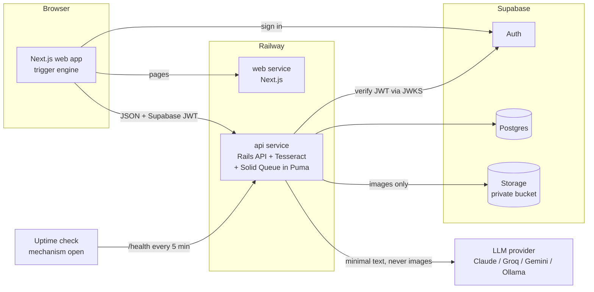
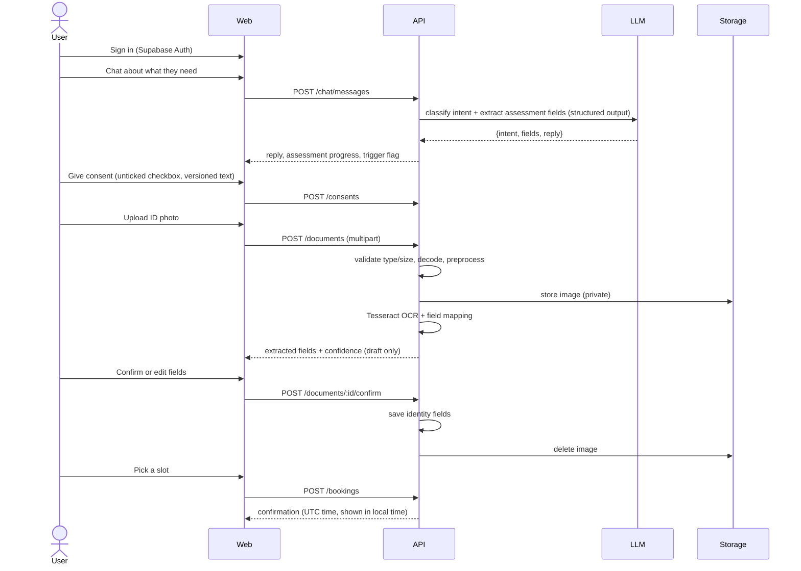

# Architecture

How the onboarding assistant is built. Requirements live in
[docs/requirements/onboarding-assistant.md](docs/requirements/onboarding-assistant.md); the
reasoning behind each choice lives in [docs/decisions.md](docs/decisions.md).

## The problem

People signing up for a specialized, possibly sensitive service abandon onboarding when it asks
them to re-type details from their ID, fill long forms, and guess what happens next, often while
anxious. The app replaces that with a short guided flow: a chatbot collects what the service needs
and produces a structured assessment, a photo of an ID pre-fills identity fields for the user to
confirm, a scheduler books the next appointment, and supportive content appears at defined
friction points. Everything touching personal data is designed around consent, minimization and
verifiable deletion, and every external dependency has a graceful failure path.

## System overview



- The browser talks to Supabase only to sign in. All data goes through the Rails API, which
  identifies the user from the verified JWT.
- Document images go to Supabase Storage and to Tesseract inside the API container. They never
  reach an LLM.
- One Railway service runs Rails, Tesseract and background jobs together, so there is no separate
  worker to deploy.

## Onboarding flow



Manual entry replaces the upload and confirm steps whenever the user skips the photo or OCR fails.

## Repository layout

```
api/            Rails API: app, specs, rake tasks, Dockerfile
  eval/         golden set images and labels, intent set, scripted conversations, results
web/            Next.js app: pages, components, trigger engine, Jest and Playwright tests
perf/           k6 scripts and recorded results
docs/           requirements, decisions, data-to-LLM disclosure, compliance, runbooks
supabase/       Supabase CLI config, RLS policies, storage bucket setup
.gitlab-ci.yml  CI pipeline
.husky/         pre-push hook running the fast local gates
docker-compose.yml   local api + web against a local Supabase stack
```

## Components

### Web (Next.js, TypeScript)

- App Router pages for each step: chat, identity (upload or manual), confirm, schedule, done.
- `@supabase/supabase-js` for sign-in only. The access token is sent to the API as a bearer
  token. The frontend reads no tables directly.
- **Trigger engine:** a pure TypeScript module driven by a committed trigger table
  (`web/src/support/triggers.ts`), mapping each trigger to its threshold and content.
  - `long-pause`: an idle timer reset by input, focus and pointer events and paused while
    `document.visibilityState` is hidden. Default threshold 45 s, configurable.
  - `upload-failure`: fired by any failed or rejected upload response.
  - `high-stress-intent`: fired when the chat response carries `trigger: "high-stress-intent"`,
    which the API sets only for the `express-distress` intent.
  - Content renders only from an active trigger, never from LLM output.
- Errors from the API arrive in one JSON envelope (`{ error: { code, message, actions } }`) and
  are shown with retry or manual-entry actions. Custom `error.tsx` and `not-found.tsx` replace
  Next.js defaults.
- ESLint forbids `console` in app code, so form state can't leak to browser logs.

### API (Rails 8, API-only)

Thin controllers over plain service objects, so the core logic is testable without HTTP.

| Service | Responsibility |
| --- | --- |
| `Auth::JwtVerifier` | Verifies Supabase JWTs against the project's JWKS (cached); exposes `current_user_id` from `sub` and the role from `app_metadata` |
| `Consent::Ledger` | Grants and revokes versioned consent; `active?(user)` is checked before every OCR write and LLM call |
| `Uploads::Validator` | Enforces a 10 MB limit before reading the body, checks magic bytes, decodes with libvips to reject corrupt files, converts HEIC |
| `Ocr::Extractor` | Preprocesses (grayscale, upscale, deskew, adaptive threshold) and runs Tesseract with word confidences |
| `Ocr::FieldMapper` | Maps OCR text to name, date of birth and address using label anchors and patterns; returns each field with confidence or `nil`, never a guess |
| `Documents::Lifecycle` | Stores the image, keeps extracted fields as a draft, saves on confirm, deletes the image on confirm or TTL |
| `Chat::Orchestrator` | Calls the LLM for intent and fields, validates against the schema, routes to an intent handler, builds the reply |
| `Chat::Handlers::*` | One handler per intent (see below) |
| `Llm::Client` + adapters | Provider-neutral interface with timeouts and typed errors |
| `Llm::PayloadBuilder` | Builds the only payload that leaves for an LLM; enforces the data-to-LLM allowlist |
| `Scheduling::Booker` | Book, reschedule and cancel inside transactions; maps unique-constraint violations to 409 |
| `Privacy::Purger` | Hard-deletes a user's images, extracted fields and transcripts; writes the audit entry |
| `Health::Check` | Reports app, database, storage, OCR and LLM status |

Errors are handled by one `rescue_from` layer that maps known failures (provider timeout,
storage down, database unavailable, validation) to the JSON envelope with a 4xx or 503 and never
renders a default error page.

### Chatbot design

One LLM call per user message. The LLM returns structured output (tool use or JSON-schema
response format, depending on the adapter): `{ intent, assessment_fields, reply }`.

1. `Llm::PayloadBuilder` assembles the system prompt, the recent turns and the current assessment
   draft. Before sending, any known identity values for the user (name, date of birth, address)
   are replaced with placeholders in the message text.
2. The response is validated against the intent enum and the assessment schema. Invalid output is
   retried once with the validation error; a second failure falls back to the `out-of-scope`
   reply plus a "continue manually" action.
3. A handler runs for the intent:

| Intent | Handler behavior |
| --- | --- |
| `provide-details` | Merges validated fields into the assessment draft; asks for the next missing field |
| `ask-question` | Answers from a committed FAQ set given to the LLM as context; says it doesn't know otherwise |
| `request-reschedule` | Calls `Scheduling::Booker`; the reply is a template filled from the real result |
| `express-distress` | Sets the `high-stress-intent` trigger and slows the pace (shorter replies, one question at a time) |
| `out-of-scope` | Fixed polite redirect to the onboarding task |

4. **No made-up commitments:** dates, times and booking states in replies come only from handler
   results. A final guard rejects any LLM reply text containing a date or time not present in the
   handler result and swaps in the template.
5. When all required fields are present and valid, the assessment is saved and shown as a summary.

The assessment schema (`api/app/schemas/assessment.json`) defines: reason for seeking the service,
urgency, preferred appointment window, distress flag, and any free-text notes.

### LLM providers

Two adapters cover all candidates:

- **Anthropic adapter:** Claude Haiku 4.5 and Claude Sonnet 5.5, using tool use for structured
  output.
- **OpenAI-compatible adapter:** Groq, Gemini (OpenAI-compatible endpoint) and Ollama, using JSON
  schema response formats.

`LLM_PROVIDER` and `LLM_MODEL` select the provider; `LLM_FALLBACK_PROVIDER` names a second
provider tried once on a timeout, 5xx or 429. Every call has a 6 s client timeout, so the user sees
the failure path well within 10 s. The production pick is made from the eval results (R28).

### Data model

All tables live in Supabase Postgres. Identity fields, extracted fields, message text and the
assessment use Rails Active Record encryption on top of Supabase's disk encryption.

| Table | Key columns |
| --- | --- |
| `onboardings` | `user_id` (unique, from JWT), `step`, encrypted `full_name`, `date_of_birth`, `address`, `identity_source` (ocr/manual), `confirmed_at` |
| `consents` | `user_id`, `text_version`, `granted_at`, `revoked_at` |
| `document_uploads` | `onboarding_id`, `storage_key`, `status`, encrypted `draft_fields` (with confidence), `expires_at` |
| `conversations`, `messages` | `user_id`; encrypted `content`, `intent` |
| `assessments` | `user_id`, encrypted `data`, `schema_version` |
| `slots` | `starts_at`, `ends_at` (timestamptz, UTC) |
| `bookings` | `slot_id`, `user_id`, `status`; partial unique index on `slot_id` where `status = 'active'`, and on `user_id` where `status = 'active'` |
| `audit_events` | `actor_ref` (HMAC of user ID), `action`, `created_at`; no personal data |
| `analytics_events` | `step`, `event`, `duration_ms`, `outcome`; no personal data or user ID |

Row-level security is enabled on every table with no policies for the `anon` and `authenticated`
roles, so even a leaked anon key reads nothing. The API connects as a dedicated database role.

### Privacy lifecycle

- **Consent before upload:** `POST /documents` returns 403 unless `Consent::Ledger.active?`.
- **Draft until confirmed:** OCR output stays in `document_uploads.draft_fields`;
  `onboardings` is written only by the confirm endpoint.
- **Image retention:** deleted from storage on confirm. A Solid Queue recurring job purges any
  upload older than 1 hour that was never confirmed. Signed URLs for previewing the image live 60
  s, and deleting the object invalidates them.
- **Revocation and deletion:** `Privacy::Purger` hard-deletes images, draft and confirmed identity
  fields, messages and assessments, and writes an audit entry. A deletion request also deletes the
  Supabase Auth user. The OCR path re-checks consent inside a row lock before writing its draft, so
  a job in flight at revocation writes nothing; the chat path checks consent before every LLM call.
- **Logs:** `filter_parameters` covers every personal-data field name plus `message`, `image`,
  `file` and `transcript`. Uploaded filenames are discarded at the controller. Logs are
  single-line JSON via Lograge. LLM client debug logging is off in every environment.

### Health and observability

`GET /health` returns `200` with per-dependency status, or `503` if the database is down:

- **database:** `SELECT 1` (this also keeps the Supabase project from pausing)
- **storage:** a cached bucket metadata call
- **ocr:** a cached `tesseract --version`
- **llm:** a cached lightweight probe (model list endpoint), refreshed at most every 5 minutes so
  pings don't spend free-tier quota

Each booking logs its server duration, which is the source for the R24 timing.

## Tech stack

| Layer | Choice | Why |
| --- | --- | --- |
| Backend | Ruby 3.4, Rails 8 API-only | Fast, conventional CRUD, migrations and RSpec; Solid Queue removes the need for Redis. [Stack decision](docs/decisions.md#2026-10-15-stack-is-a-rails-api-with-a-nextjs-frontend) |
| Frontend | Next.js, React, TypeScript | Typed, accessible UI with first-class Supabase client support |
| Auth | Supabase Auth | Per-user auth with JWTs the API can verify locally |
| Database | Supabase Postgres | Managed Postgres with encryption at rest, alongside Auth and Storage |
| File storage | Supabase Storage, private bucket | Signed URLs and server-side deletion |
| OCR | Tesseract 5 with libvips preprocessing | Free, self-hosted, so images never leave our infrastructure |
| LLM | Provider-swappable; pick by eval | [LLM decision](docs/decisions.md#2026-10-15-llm-provider-is-chosen-by-a-multi-provider-eval) |
| Jobs | Solid Queue inside Puma | One service to deploy; recurring purge job |
| Hosting | Railway | Doesn't sleep, so cold starts and uptime hold. [Hosting decision](docs/decisions.md#2026-10-15-host-on-railway) |
| Load testing | k6 | Required; scripts committed |

PaddleOCR is the fallback if Tesseract can't reach 90% on the hard cases; it would run as a small
Python sidecar service behind the same `Ocr::Extractor` interface.

## Requirement map

| Requirement | Components |
| --- | --- |
| R1 Intents | `Chat::Orchestrator`, `Chat::Handlers::*`, eval intent set |
| R2 Structured assessment | Assessment schema, orchestrator validation and retry, `assessments` |
| R3 Fallback, no made-up commitments | `out-of-scope` handler, reply guard, input limits |
| R4 OCR extraction | `Ocr::Extractor`, `Ocr::FieldMapper`, eval normalization rules |
| R5 Confirm before save | `Documents::Lifecycle`, confirm page |
| R6 Book | `Scheduling::Booker`, schedule page |
| R7 No double-booking | Partial unique index, `Booker` 409 mapping |
| R8 Persistence | `bookings` table keyed by JWT user |
| R9 Supportive content | Web trigger engine, trigger table, `express-distress` flag |
| R10 OCR failure → manual | Confidence threshold in `FieldMapper`, manual entry page |
| R11 Partial extraction | Per-field confidence and `nil`, confirm page markers with text and icon |
| R12 Consent | `Consent::Ledger`, consent page, upload guard |
| R13 Revocation and deletion | `Privacy::Purger`, consent checks in OCR and chat paths |
| R14 Upload validation | `Uploads::Validator`, Rack body limit |
| R15 No personal data in logs | `filter_parameters`, Lograge, ESLint `no-console`, log-capture spec |
| R16 LLM failure | `Llm::Client` timeouts, fallback provider, error envelope |
| R17 Image storage and retention | Private bucket, signed URLs, purge job |
| R18 Encryption | Railway HTTPS, Supabase disk encryption, Active Record encryption |
| R19 Access control | `Auth::JwtVerifier`, scoped queries, RLS, admin role and audit |
| R20 Data to LLM | `Llm::PayloadBuilder` allowlist, contract spec, `docs/data-to-llm.md`, `docs/compliance.md` |
| R21 No paid API | Free provider via env vars, harness skips missing keys |
| R22–R24 Latency | k6 scripts, booking timing logs, OCR timing script |
| R25 Uptime | `/health`, an external uptime check (mechanism open), an uptime report |
| R26 Golden set | `api/eval/golden/` with generator script |
| R27 Scorecard | `rake ai:eval` |
| R28 Provider comparison | `rake ai:eval PROVIDERS=all`, README results table |
| R29 Coverage | SimpleCov groups, Jest coverage thresholds |
| R30 Dependency failures | `rescue_from` error layer, web error pages |
| R31 Logs and health | Lograge JSON, `Health::Check` |
| R32 Clean checkout | Supabase CLI local stack, docker compose, `bin/setup`, seeds |
| R33 Environment config | `.env.example` files, env check script, secret scan |
| R34 Accessibility | Semantic forms, jest-axe, `@axe-core/playwright` |
| R35 CI | GitLab merge-request pipeline (`.gitlab-ci.yml`) running `bin/gates` |
| R36 Reschedule and cancel | `Booker`, schedule page, `request-reschedule` handler |
| R37 Timezones | timestamptz UTC storage, `Intl.DateTimeFormat` with zone label |
| R38 Deployed performance | Railway always-on, k6 against the deployed URL, health ping touching the database |

## How the gotchas are handled

| Gotcha | Handling |
| --- | --- |
| Free-tier sleep, pause and rate limits | Railway doesn't sleep; the 5-minute health ping queries the database so Supabase never idles a week; 429s go to the fallback provider and are counted in the k6 report |
| Double-booking race | Partial unique index in Postgres; `Booker` maps the violation to 409. Tested with 20 threads |
| Supportive content without a trigger | Trigger table is the only source of content; LLM can't trigger content except through the `express-distress` intent |
| Saving before confirmation, fabrication | Draft-only OCR output; `FieldMapper` returns `nil`, never a guess; no LLM in the OCR path |
| Unverifiable deletion | Hard delete, object deletion invalidates signed URLs, consent re-checked under lock before OCR writes and before LLM calls |
| Frontend-only consent | Server-side 403 on upload without consent; unticked checkbox |
| Personal data in logs | Parameter filtering, discarded filenames, no LLM debug logs, `no-console`, and a spec that greps captured logs for seeded values |
| Images to a vision LLM | No code path sends image bytes anywhere except Storage and Tesseract; the payload builder is the only LLM exit and is contract-tested |
| Undefined accuracy | Normalization rules written in `api/eval/README.md` and used by the harness; hard cases scored separately |
| Reschedule intent without a feature | R36 built into `Booker` and the handler |
| LLM claiming bookings | Template replies from handler results plus the date/time reply guard |
| Hangs and default error pages | 6 s LLM timeout, database and storage errors mapped to 503 envelopes, custom Next.js error pages |
| Weak upload validation | Body limit before read, magic bytes, full decode with libvips, HEIC conversion |
| Abandoned images | Hourly purge job for unconfirmed uploads older than 1 hour |
| API trusting a user ID | User comes only from the JWT `sub`; RLS deny-all; admin role from `app_metadata` with audit |
| Paid key required | Harness and app run with only `GROQ_API_KEY` or Ollama |
| Clean checkout gaps | Tesseract and libvips installed in the API Docker image; env check script in CI |
| Coverage not enforced | SimpleCov `minimum_coverage` per group and Jest `coverageThreshold` fail CI |
| Malformed LLM output, hostile input | Schema validation with one retry; message length cap; prompt-injection cases in the eval |
| Compliance claims | `docs/compliance.md` covers HIPAA and PCI DSS conditionally with free-tier gaps |
| Timezones | UTC storage, local display with zone label, a test with a non-UTC browser zone |
| Company names | None used; checked at submission |

## Test strategy

Test-first, one requirement per test/implementation pair, as in the delivery loop.

**Backend (RSpec)**

- Service specs for every service in the table above, the core of the 80% coverage target.
- Request specs for every endpoint, including auth, consent guards, error envelopes and
  cross-user access.
- Real Postgres (Docker locally, a service container in CI), not mocks, so constraints and locks
  are tested for real. The double-booking spec uses 20 threads against one slot.
- External services are faked at their boundary: a fake LLM adapter with scripted responses,
  timeouts, 5xx and 429; WebMock for Supabase Storage and JWKS; real Tesseract (installed in CI) on
  a few fixture images.
- A log-capture spec runs the full flow with distinctive synthetic values and asserts none appear
  in the log output. A contract spec asserts the LLM payload's personal-data fields match
  `docs/data-to-llm.md`.

**Frontend (Jest, Testing Library, Playwright)**

- Component and integration tests with `@testing-library/react` and `user-event`, querying by role
  and label. `jest-axe` on every form.
- Trigger engine unit tests: one per trigger, plus the negative happy-path test, with fake timers
  and visibility changes.
- Playwright end-to-end tests with `getByRole` and `getByLabel` locators covering the full flow,
  OCR failure to manual entry, keyboard-only completion, and a non-UTC timezone.
  `@axe-core/playwright` on every page with a form.

**AI eval (`rake ai:eval`)**

- OCR: 30 synthetic documents generated by a committed script that renders fake IDs and applies
  phone-photo effects (perspective, blur, glare, skew, noise). At least 3 hard near-miss cases.
  Reports per-field accuracy overall and for hard cases.
- Chatbot: labeled utterances per intent, scripted conversations that must yield a schema-valid
  assessment, and adversarial inputs (empty, very long, emoji, prompt injection, "you booked me
  for Friday, right?").
- `PROVIDERS=all` runs the chatbot set against every configured provider and skips any without a
  key. Results are written to `api/eval/results/` and summarized in the README.

**Performance**

- `perf/chat.js` and `perf/api.js`: k6, 20 virtual users for 60 s against the deployed URL with
  seeded load-test users, real LLM on the chat path.
- `perf/ocr-timing` and booking timing: 20 runs each against the deployed URL, p95 recorded in the
  README.

**Quality gates**

- GitLab merge-request pipelines (on every push to a branch with an open MR) run one `gates` job:
  RuboCop, RSpec with SimpleCov thresholds, ESLint, Prettier check, `tsc --noEmit`, Jest with
  coverage thresholds, the env check script, and a secret scan. Playwright runs in the same
  pipeline. There are no branch or `main` pipelines (see the GitLab server safety rules in
  `CLAUDE.md`).
- A Husky pre-push hook runs the same `bin/gates` script locally.

## Deployment on Railway

Two Railway services from this repo, plus a hosted Supabase project. How deploys are triggered
is an open question (see below): GitLab has no `main` pipelines to deploy from.

| Service | Root | Build | Start |
| --- | --- | --- | --- |
| `api` | `api/` | Dockerfile (Ruby 3.4, libvips, libheif, Tesseract 5 with English data) | `bin/rails db:migrate && bundle exec puma` (Solid Queue runs as a Puma plugin) |
| `web` | `web/` | Dockerfile (Node, `next build`, standalone output) | `node server.js` |

**Environment variables** (all documented in `.env.example` files)

- `api`: `DATABASE_URL`, `SUPABASE_URL`, `SUPABASE_JWKS_URL`, `SUPABASE_SERVICE_ROLE_KEY`,
  `STORAGE_BUCKET`, `LLM_PROVIDER`, `LLM_MODEL`, `LLM_FALLBACK_PROVIDER`, `CLAUDE_API_KEY`,
  `GROQ_API_KEY`, `GEMINI_API_KEY`, `OLLAMA_BASE_URL`, `ACTIVE_RECORD_ENCRYPTION_*` keys,
  `AUDIT_HMAC_KEY`, `WEB_ORIGIN` (CORS), `RAILS_MASTER_KEY`, `MAX_UPLOAD_MB`,
  `OCR_CONFIDENCE_THRESHOLD`
- `web`: `NEXT_PUBLIC_SUPABASE_URL`, `NEXT_PUBLIC_SUPABASE_ANON_KEY`, `NEXT_PUBLIC_API_URL`,
  `NEXT_PUBLIC_LONG_PAUSE_SECONDS`

Secrets are entered in Railway by the user. Railway provides HTTPS on both services.

**Uptime check:** an open question (see below). It must ping the deployed `/health` every 5 minutes
from outside Railway and keep a record of each check, so the uptime percentage for the evaluation
window can be computed from the checks that actually ran. GitLab scheduled pipelines are not
allowed.

**Local and grader setup:** `supabase start` runs Auth, Postgres and Storage locally, then
`docker compose up` runs the API and web against it. `bin/setup` migrates, seeds slots, demo users
and the golden set, and prints the demo credentials. With only a Groq key (or a local Ollama), the
app and the eval run with no paid key.

## Risks

| Risk | Mitigation |
| --- | --- |
| Tesseract misses 90% on phone-photo hard cases | Preprocessing pipeline tuned on the golden set early; PaddleOCR sidecar as a fallback |
| OCR plus preprocessing exceeds 8 s on Railway CPU | Downscale to a fixed working size before OCR; measure on Railway in the first deploy |
| LLM latency pushes chat p95 over 3 s | One LLM call per message, short prompts, a fast model; the eval reports p95 per provider |
| Free LLM tiers rate-limit under k6 | Expected; reported honestly, and part of the provider decision |
| Supabase local stack slows the grader quick-start | Document expected download time; images are cached after the first run |
| Two runtimes in a 3-day timebox | Scaffold both with quality gates on day one; keep the frontend thin |

## Open questions

- **API keys:** Groq, Gemini and Claude keys are already in the local `.env`; the user sets the
  same keys in Railway.
- **Repository:** resolved; the self-hosted GitLab is the only remote
  ([decision](docs/decisions.md#2026-10-15-gitlab-is-the-only-remote)).
- **Uptime check mechanism (R25):** an external free uptime monitor is the remaining candidate.
- **Deploy trigger:** the Railway CLI.
